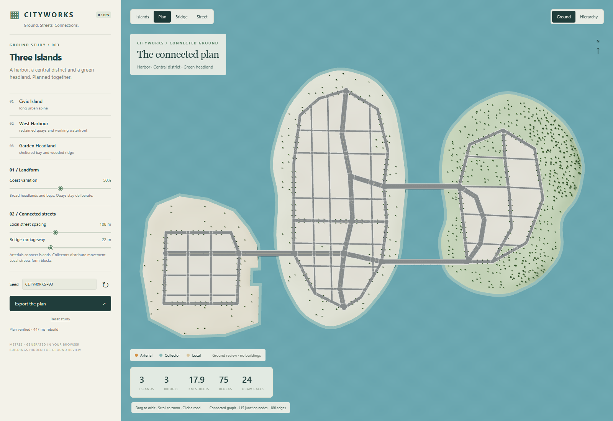

# Cityworks

A deterministic city planning prototype with a Three.js preview and engine-neutral city data.

**Development: 0.3 ground and connected streets.** Three islands, three bridges, a continuous street network and terrain. Buildings are intentionally absent from this milestone so the ground can be reviewed on its own. The [published 0.2 demo](https://tront.xyz/cityworks/) remains available while this branch is reviewed.



## Run

Open `index.html` in Chrome, or serve this directory with `python -m http.server 8000` and visit `http://localhost:8000`. Runtime dependencies are vendored; generation happens in your browser.

Change coast variation, local street spacing, bridge carriageway width or seed. The island buttons focus each district. Plan, bridge and street views expose the layout at different scales; Hierarchy highlights arterial, collector and local routes. Drag to orbit/look, scroll to zoom, and use WASD plus Q/E in bridge/street views. Click a road to inspect its identity and width. Export saves Cityworks JSON schema 3.

## What 0.3 adds

- Distinct central urban island, reclaimed harbor and wooded headland, using controlled landform shapes rather than high-frequency coast noise.
- Three explicit bridges attached to land-side arterial junctions. Either eastern crossing can be removed without disconnecting the network.
- 22 m arterial, 13 m collector and 7 m local carriageways, with separate sidewalk widths and 0.16 m curbs.
- Shared graph junctions, unioned asphalt, continuous right of way and blocks derived from that coverage.
- Coastal slopes, graded urban pads and natural headland relief. Bridge slabs, piers, railings and landings use model dimensions.
- Directional crosswalk clearance at oblique junctions and dry-road materials adapted from MIT-licensed Slop New York code.

## Test and build

```sh
npm test
python tools/build.py
```

Node runs the retained 0.2 tests, the new archipelago tests and emitted road-marking geometry tests. No npm install is required. The build produces `artifacts/v0.3/Cityworks-0.3.0-dev.html`, a self-contained offline app with all dependency notices embedded.

For browser verification, install Python Playwright and Google Chrome:

```sh
python -m pip install playwright
python tools/verify_ground_browser.py
```

The harness uses isolated muted headless Chrome and writes captures/reports under ignored `artifacts/`. An optional `--browser-executable PATH` selects another installed Chrome executable.

## Scope and review

This is an authored three-island planning grammar with bounded seed variation, not a general island or road-network editor. Roads and bridge decks use a common 8 m grade; bridge clearance is conceptual. Buildings/parcels, traffic, collisions, bridge engineering, accessibility details, LOD and a Unity importer are not part of this milestone. The renderer and vegetation remain simpler than Slop New York; no visual or device-performance equivalence is claimed.

Read the [v0.3 data contract](docs/V03_CONTRACT.md), [verification and visual review](docs/V03_REVIEW.md), [matched surface and landing comparisons](docs/V03_SURFACES.md), [development scope](docs/V03_PLAN.md) and [dependency provenance](docs/PROVENANCE.md). Earlier [0.2 contract](docs/CONTRACT.md) and [verification](docs/VERIFICATION.md) remain for that release.

## Licensing

No project-wide license has been selected for original Cityworks code. Third-party dependencies and adapted components retain their licenses. See [THIRD_PARTY_NOTICES.txt](THIRD_PARTY_NOTICES.txt).
