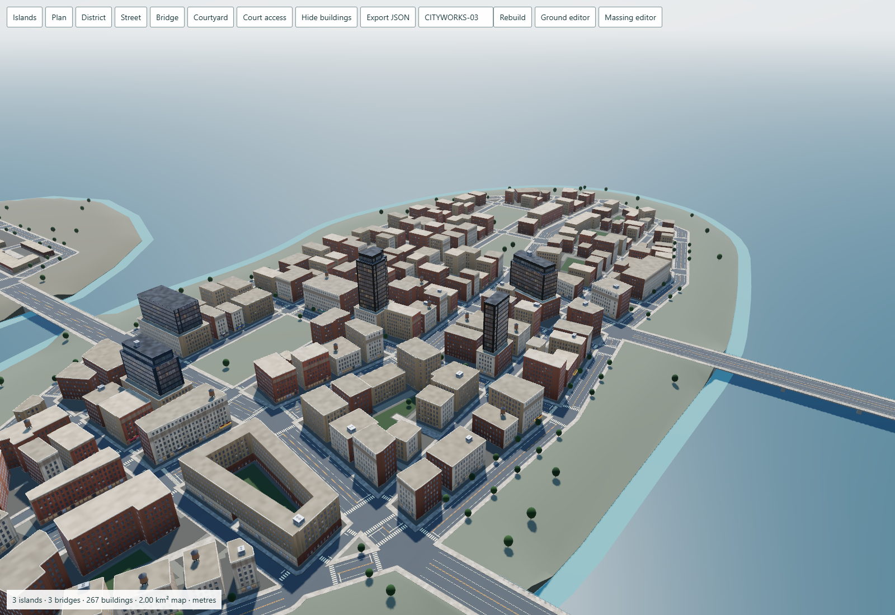

# Cityworks

A deterministic city planning prototype with a Three.js preview and engine-neutral city data.

[Open Cityworks](https://tront.xyz/cityworks/) to explore the integrated three-island city. The default plan has a 2 km² bounding envelope, connected streets and bridges, 267 buildings, 279 volumes, seven planned taller outliers across all three islands and 25 shared block interiors. The building renderer uses documented MIT adaptations of the pinned Slop New York facade system.



## Run and edit

Serve the repository with `python -m http.server 8000` and open `http://localhost:8000/`. Use a WebGPU-capable Chrome browser. The integrated preview loads Three.js from a commit-pinned CDN and needs network access; generation happens locally in the browser.

Use **WASD** to move, hold the **right mouse button** to look, use **Q/E** down/up and **Shift** for faster movement. Orbit remains optional. Camera presets, building visibility, seed changes and schema 4 JSON export remain available. Click a building to edit its height. The **Ground editor** link opens the preserved land/street editor, where coast variation, street spacing and bridge width remain editable. **Open city** brings those settings back into the integrated preview. Changes to the ground regenerate parcels and buildings.

The [ground-only editor](https://tront.xyz/cityworks/ground-editor.html) retains its hierarchy view, road inspection, mobile controls and schema 3 export. Its dependencies are vendored, and `ground-editor.html` can also open directly from disk.

The [scoped massing editor](experiments/scoped-editor/README.md) is available through **Massing editor**. Select buildings, lock them, reroll a block, undo/redo and save an editable project. It preserves neighboring map records and exports an engine-neutral scene contract. The default route remains the city preview.

## Build and verify

```sh
npm test
npm run build
python tools/verify_release.py
```

The build updates the default `index.html` from the maintained integration entry and writes `artifacts/three-island-integration/Cityworks-Three-Island-Integration.html`. That single-file preview bundles local modules and keeps the pinned Three.js CDN dependency. `npm run build:ground` builds the separate offline ground editor.

The release browser harness uses isolated muted headless Chrome and verifies the default route, integrated controls, JSON export, mobile layout and a round trip through the ground editor. Use `--url https://tront.xyz/cityworks/` to verify a deployment. Python Playwright and installed Google Chrome are required. Full geometry and visual checks remain in `experiments/three-island-integration/verify_browser.py`; the retained ground harness is `tools/verify_ground_browser.py`.

## Scope and evidence

The [0.5.3 release notes](docs/RELEASE_053.md) document connected frontage routes, paired curb ramps, glazed door modules and continuous paving/planting in place of raised parcel pads. Existing massing, metric dimensions, locks and facade domains remain intact.

The [0.5.2 release notes](docs/RELEASE_052.md) document coherent facade domains, full opening rows, clearer interior mapping and fly navigation. Matched fixtures and city views retain the same draw, triangle and material counts.

The [0.5.1 release notes](docs/RELEASE_051.md) document minimum usable footprints, deliberate clearances, full-size window bays, solid narrow returns, map dimensions and project compatibility. The map envelope is approximately 1.821 × 1.098 km; roads and building dimensions retain their metric scale.

This is an authored three-island grammar with bounded seed variation. It is not a general GIS or engineering tool. The same ground/road model feeds parcels, explicit footprint rings and building volumes. Shared courts reserve access before subdivision; building footprints must fit land, parcel setbacks and road/sidewalk exclusions. Identity is stable for deterministic rebuilds and unaffected edits within this generator revision, not across arbitrary algorithm migrations.

The [integration verification](experiments/three-island-integration/VERIFICATION.md) includes matched baseline and NYC comparisons, geometry checks and measured render costs. The [adapter change inventory](experiments/three-island-integration/ADAPTER_CHANGES.md) identifies every derivative module. Earlier source experiments remain available for study and regression checks.

Facade and roof repetition, plain ground floors, coarse terrain transitions and simple bridges remain. Traffic, authored landmarks, full-app reflections/post-processing and night lighting are absent or untested. Courtyard height edits at or below 6.8 m leave an uncovered entrance. This release does not claim parity with the full Slop New York app or device performance targets.

## Licensing

No project-wide license has been selected for original Cityworks code. Third-party dependencies and adaptations retain their licenses. See [THIRD_PARTY_NOTICES.txt](THIRD_PARTY_NOTICES.txt) and [provenance](docs/PROVENANCE.md). Surveyed NYC geometry used for comparison is not included in the runnable city or repository.
