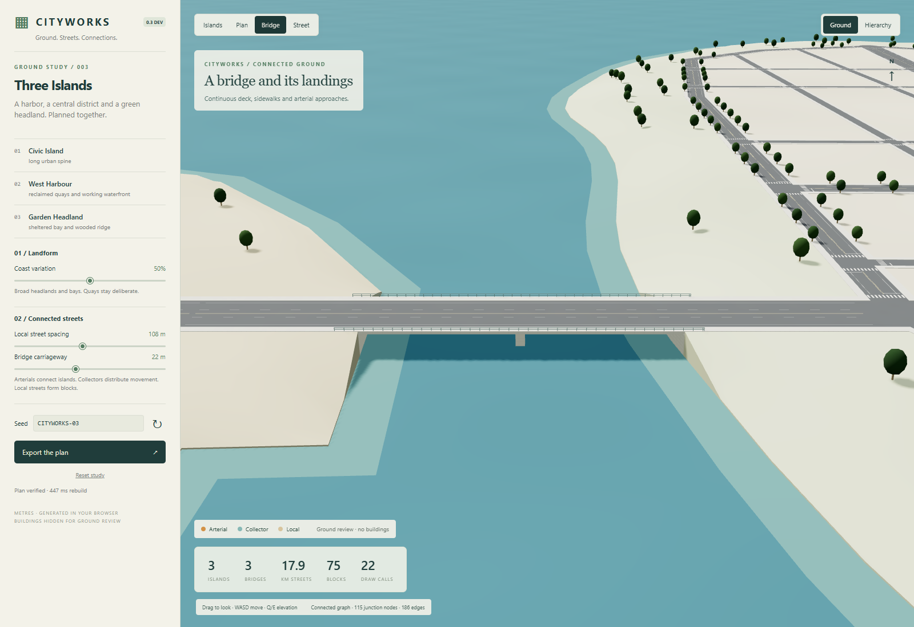
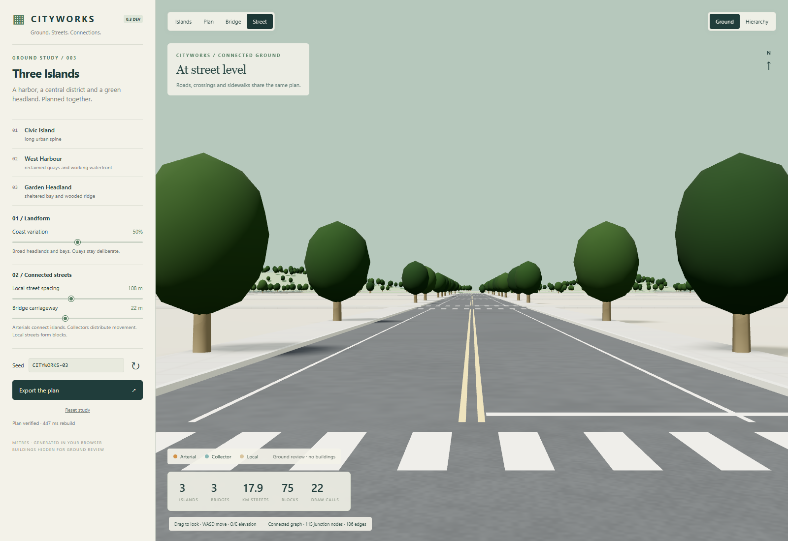

# Version 0.3 ground milestone review

Verified 2026-10-28. This development milestone is not deployed over the published 0.2 release. The [surface and landing follow-up](V03_SURFACES.md) records matched comparisons and the additional rendered-mesh checks.

## Ground-only evidence

The central island has a bent arterial spine and smaller local blocks. The harbor has deliberate quay geometry and an orthogonal working district. The headland has a looser collector network, coastal slopes and wooded relief. Three bridges connect the plan; the eastern pair provides an alternate route.

The bridge view exposes the land-side connections, continuous slab and sidewalks, railings and supports. Asphalt is unioned once. The hidden overlapping slab top was removed to prevent depth fighting at overview distances.

Street markings use directional intersection clearance, with compact sidewalks and curb risers. Dry-road aggregate, repairs and seams are a bounded MIT-licensed adaptation from Slop New York. Architecture remains absent during ground review.

## Checks

- Retained 0.2 model suite: seven groups and 36 seed/control cases.
- Archipelago suite: six groups and 12 varied seed/control cases, including graph connectivity, shared crossings, land containment, bridge landings and redundancy, block containment/nonoverlap, determinism and terrain grade.
- Emitted paint suite: six cases, 19,809 actual mesh strips and 15,225 zebra bars. Checks finite attributes, upward unit normals, asphalt containment and no intrusion into neighboring approaches. The previous circular-clearance implementation fails this test.
- Additional independent review: 90 topology cases without unexpected crossings, overlapping collinear edges or ordinary corridors outside land; 16 paint cases without intrusions; 15,044 mixed-block samples at the intended grade. Final overhead, bridge, street and headland pixel review passes. Review found and verified fixes for oblique crosswalk overlap, backwards curb faces, slab width/thickness mismatch and floating park planes.
- Muted headless Chrome: four primary views plus hierarchy and headland captures; control edits, schema-3 JSON export and stable resources after three rebuilds. No console errors, nonfinite geometry or invalid normals.

Default model: 1.435 km² land, 17.865 km streets, three bridges, 75 blocks, 91 multiway junctions and zero dead ends. Carriageway lengths: 3.460 km arterial, 6.634 km collector and 7.771 km local.

Baseline `6ef61fd`, measured on desktop Chrome ANGLE D3D11, RTX 5070 Ti, 1600×1100, DPR 1: 24 full-frame draw calls in the overview, 192,537 submitted triangles including shadows/instances, 17 resident geometries, one shadow texture, 12 shader programs and approximately 1.30 MB of vertex attribute buffers. The measured initial model/scene rebuild was 308 ms. Frame intervals were refresh-paced near 16.7 ms; these are not uncapped GPU timings or mobile/Quest evidence. Current follow-up costs are listed in the surface review.

## Reference comparison and remaining work

The owner's existing island model was studied for coastal distance, terrain and inter-island connectivity; an existing street generator was rendered for actual plan/detail comparison. The live [Slop New York](https://mrdoob.github.io/slop-newyork/) scene was also rendered. Reference captures stay outside this repository; their geographic assets were not imported.

This milestone improves structural ground coherence. It does not reach Slop New York's visual finish: vegetation is still simple, large development blocks are bare, lighting is basic and architectural frontage/detail is absent. The next building pass should address footprint and height variety, facade/material families and grounded street frontage using explicitly attributed reuse where appropriate.

Other limits: authored layout grammar, bounded coast variation instead of a full island editor, flat road grades, conceptual bridges, one indispensable harbor crossing, no drainage/accessibility/traffic simulation, no Unity importer and no general route authoring. Review and merge approval are required before this development branch replaces the live release.
