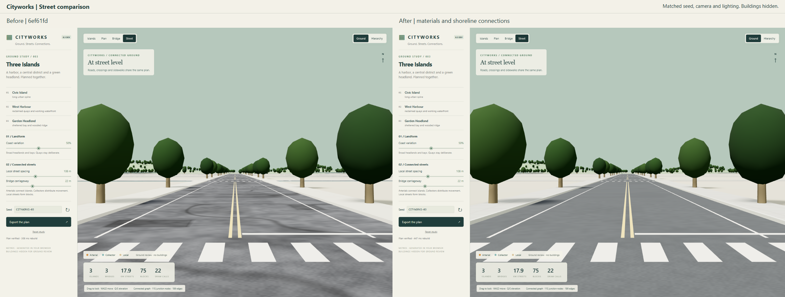
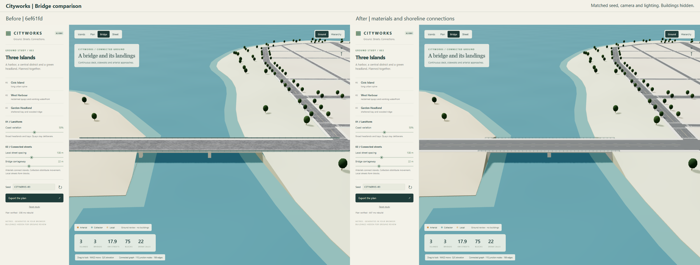
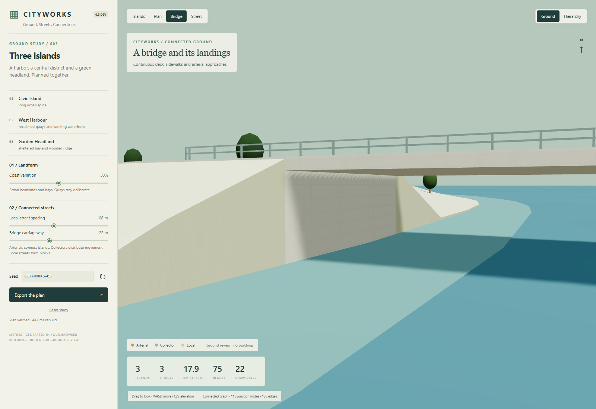

# Street materials and shoreline connections

This follow-up preserves the `6ef61fd` ground plan, graph, seed and camera framing. Buildings remain hidden.

The asphalt now uses restrained broad variation, finer aggregate and fewer utility patches. Sidewalk panels measure 1.5 m in world coordinates. A separate 0.18 m curb top and vertical curb faces give the carriageway a readable edge. The panel grid remains aligned to world axes; this pass does not add individually aligned paving for every road.

The initial bridge mesh had three defects beyond material contrast. Sparse coast-wall vertices missed raised terrain beside the bridge. Decorative abutments sat at inland graph endpoints. Full-length rails extended into approach junctions.

Coastal wall vertices now match the sampled terrain edge, with concrete support faces at actual shoreline crossings. The visible deck and rails cover the full-width water crossing and a short buried land overlap. Rails stop clear of the inland junctions. Outer sidewalk faces close the raised pavement edge, and support geometry is combined into one shared batch.

## Verification and measured cost

The unchanged model and road-paint suites pass. The independent rendered-mesh checker passes the default plan and both control extremes. It checks actual mesh vertices and projected footprints, including the full sidewalk surface. The minimum-control case exposed two micrometre-wide curb triangles that reversed during Float32 conversion; the renderer now discards faces that collapse or reverse when packed for the GPU. The exact combination remains a regression case.

The final browser run also passed the edited plan, six close landing captures, all controls, JSON export, finite geometry/normals and stable resources after three rebuilds. Default and edited plans have zero measured open shore gaps, zero rail/post overlap with asphalt, and no road or sidewalk over water without slab support. Each case checks 18 shore-support samples. The sidewalk coverage residual is under 0.032 square metres, within the 0.05 square metre quantization tolerance.

Matched desktop captures use 1600x1100, DPR 1, Chrome ANGLE D3D11 and RTX 5070 Ti. Submitted triangles include shadows and instances.

| Measure | Baseline 6ef61fd | Follow-up |
| --- | ---: | ---: |
| Overview draw calls | 24 | 24 |
| Submitted triangles | 192,537 | 196,270 |
| Resident geometries | 17 | 17 |
| Shader programs | 12 | 14 |
| Vertex attribute bytes | 1,300,808 | 1,509,536 |
| Initial model/scene build, single capture | 308 ms | 447 ms |

Frame intervals remain refresh-paced around 16.7 ms; these are not uncapped GPU timings or mobile performance evidence. The full mesh coverage test takes roughly a minute per case and runs only in the verification harness.

The close views still reveal a jagged shadow edge under some decks. Mesh checks confirm this is not an open shoreline seam. Shadow filtering and contact bias remain rendering work for a later pass.

The model remains an authored layout with flat road grades and conceptual bridge dimensions. This is a visual and geometric continuity improvement, not structural engineering validation. Lighting, vegetation, terrain treatment and future architectural frontage still need substantial work to approach the reference's finish.
