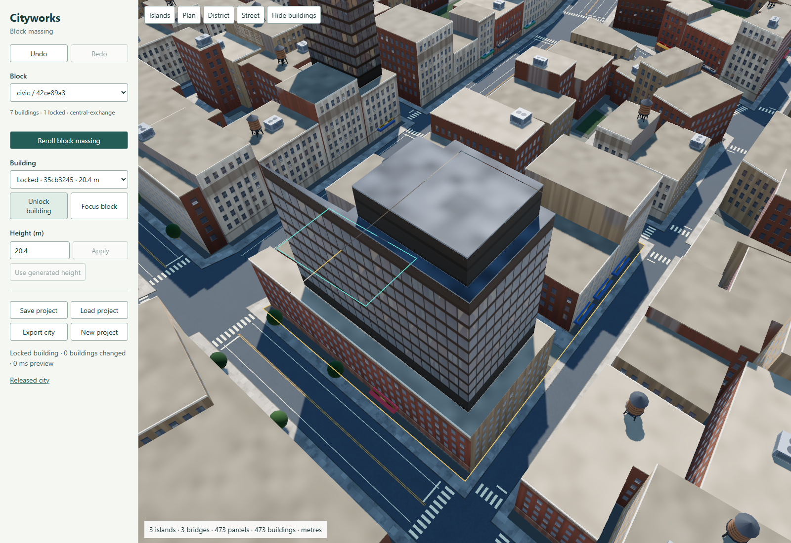
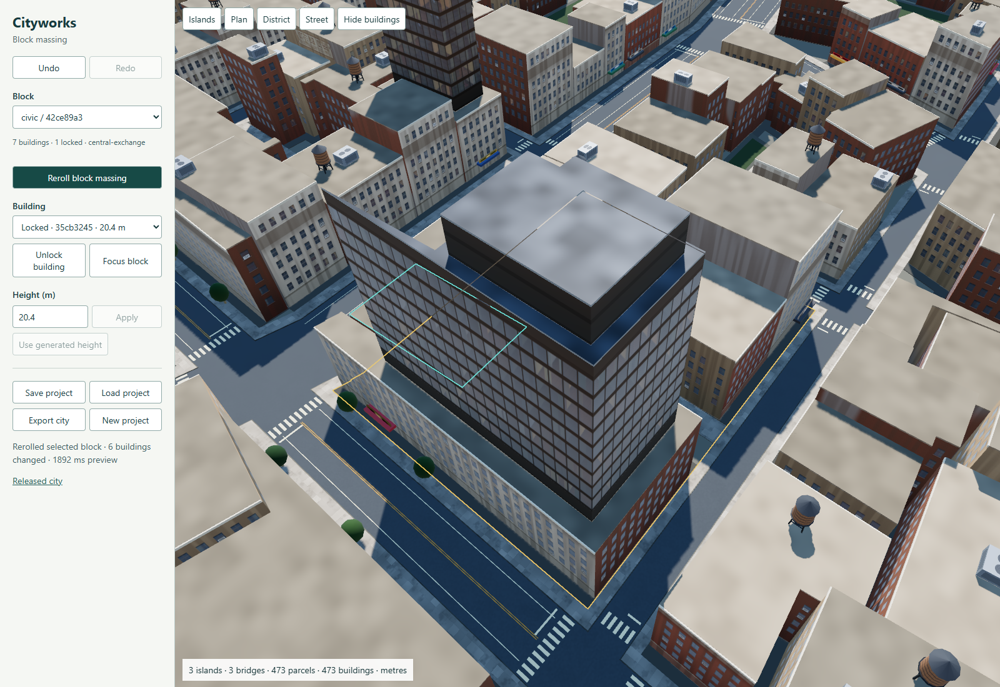

# Scoped massing editor

This development editor adds authoritative saved edits around the existing three-island generator and New York building preview. It is a bounded editing slice, not a replacement for the released city or a complete city-building game.

From the repository root, run `python -m http.server 8000` and open `http://localhost:8000/experiments/scoped-editor/` in WebGPU-capable Chrome. The pinned Three.js CDN requires network access. Serve the files on one origin; opening this page directly from disk is not supported.

1. Click a building in the preview or choose a block and building in the controls.
2. Lock one building, then use **Reroll block massing**. Unlocked buildings receive new scoped massing/facade seeds. Streets, parcels and neighboring building records stay unchanged.
3. Use **Undo** and **Redo** or Ctrl/Cmd+Z and Ctrl/Cmd+Shift+Z. Manual height edits, locks and loading a project are also undoable.
4. **Save project** preserves edits and locks as compact JSON. **Load project** validates that authoring document before replacement. Browser autosave restores the same state on reload; the 30-entry undo history is session-only.
5. **Export city** writes the derived scene, source authoring state, metric coordinates, symbolic materials and polygon collider descriptions for a later engine-specific importer.

## Verification

`npm test` includes nine editor transaction groups covering locked/manual values, scope, exact undo/redo, saved reconstruction, invalid and stale transactions, all-locked no-ops, independent edit order and scene export. It also runs the existing city, archipelago, road and building-plan regressions.

`python tools/verify_scoped_editor.py` passed actual desktop/mobile interaction, viewport picking, JSON downloads/import/reload, invalid import preservation and three repeated reroll/undo cycles. The pictured block contains seven buildings; six unlocked records changed. Land, streets, bridges, parcels and every building outside the selected block remained byte-identical.

At the matched district camera, the test measured 88 draw calls before and after, 388,880 versus 388,736 rendered triangles, 41 materials including two selection outlines, 43 renderer geometries and 13 textures. Reported renderer memory was 179,662,153 bytes for all three samples. These are this browser's counters, not a GPU lifetime proof or a Unity/Quest performance estimate. See [the report](evidence/report.json) and [mobile capture](evidence/mobile.png).

## Limits and next boundary

Massing rerolls vary existing profile heights and facade/detail seeds. They do not resubdivide parcels, move footprints, redesign tower profiles or edit streets. The editor rebuilds the full model and isolated preview after a geometric edit, then commits the validated project; a pictured reroll took about two seconds including preview replacement. Lock-only edits avoid that rebuild. This implementation prioritizes correct authoring transactions before incremental rendering.

The [editing contract](../../docs/EDITING_CONTRACT.md) defines future terrain/street/footprint invalidation and the Unity export boundary. No Unity importer, collider cooking, shader translation, terrain sculpting or street dragging is implemented. Existing visual shortcomings in island shape, repeated architecture and block interiors remain; this editor does not establish parity with the New York reference.
